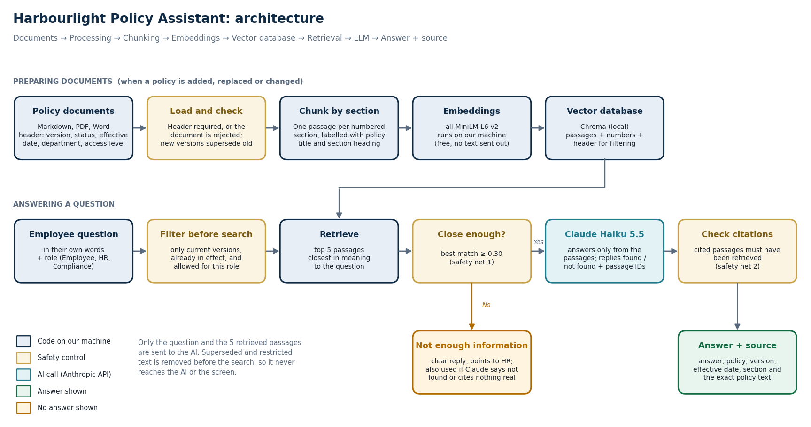

# Casino Employee Knowledge Assistant

An internal assistant that answers employees' policy questions **only from approved
company documents**, shows the document and section it used, and says clearly when
the answer isn't in the documents.

Week 3 project (RAG Knowledge Management Product). **Status: working app, evaluated (32 questions) and experiments done. Results: [evaluation sheet](evals/casino-knowledge-assistant-evaluation.xlsx), [experiments](docs/casino-knowledge-assistant-07-experiment-results.md).**

**Start here:** [Product document](docs/casino-knowledge-assistant-01-product-document.md) (problem, users, scope, architecture, decisions, risks, limitations, next steps)



All documents in `data/policies/` are **mock documents for a fictional company**,
written for this project. They are not real policies and not legal advice.

## How it works

```
Question + role → filter: current, in effect, allowed for this role → find closest policy sections
  → nothing close enough? "not enough information" (AI not called)
  → Claude Haiku 5.5 answers from those sections only, in a fixed format
  → code checks the cited sections were really found → answer + policy + section + exact text
```

Old versions and restricted documents are removed **before** searching, so they can never reach the AI
or the screen. [The 11 decisions behind this →](docs/casino-knowledge-assistant-03-decision-log.md)

## Run it

```bash
python3.12 -m venv .venv && .venv/bin/pip install -r requirements.txt
cp .env.example .env            # then paste your Anthropic API key into .env yourself
.venv/bin/streamlit run app/streamlit_app.py
```

The search index is built automatically on first run (the free embedding model downloads once, ~80 MB).
With no API key, set `LLM_PROVIDER=mock` to try the app without AI (answers are clearly marked as not AI).
Uploads only work when `ALLOW_UPLOADS=true` is in `.env`. Without it (as on the public site) the Upload tab is switched off.

| Command | What it does |
|---|---|
| `.venv/bin/python -m pytest` | 43 tests: loading, chunking, filters, answer safety nets, uploads, evaluation marking |
| `.venv/bin/python -m app.build_index` | Rebuilds the search index for all three chunking methods |
| `.venv/bin/python -m evals.run_eval` | Runs the 32 evaluation questions with Claude and scores them (under 1p) |
| `.venv/bin/python -m evals.run_experiments` | Chunk size, top 3 vs 5 and version-filter experiments (about 5p) |
| `.venv/bin/python -m evals.make_sheet` | Rebuilds the evaluation spreadsheet from the results |

## Layout

| Folder | What's in it |
|---|---|
| `data/policies/` | Mock policy documents, each with a metadata header |
| `app/pipeline/` | Loading, chunking, search, answering |
| `app/streamlit_app.py` | The app: Ask, Policy library, Upload, How it works |
| `config/roles.yaml` | Which documents each role can search |
| `prompts/` | The instructions given to the AI |
| `docs/` | 01 product document, 03 decision log, 04 architecture diagram (and the script that draws it), 07 experiment results |
| `tests/` | Automated tests |

## The document set

17 mock documents for the fictional **Harbourlight Casino Group**. Some are built in on purpose to test
the assistant:

| Test | Documents |
|---|---|
| Old vs new version (same title) | Annual Leave Policy **2024** (superseded) vs **2026** (current). Carry forward 5 days by 31 Mar vs 8 days by 30 Jun |
| Old vs new version (different title) | Hybrid Working Policy 2023 (superseded) vs Remote and Workplace Policy 2025 (current). 3 vs 2 remote days |
| Similar policies that could be confused | Annual leave vs sickness absence; Information Security vs IT Acceptable Use; Incident Reporting vs Compliance Guidelines |
| Answer spread across sections | Annual Leave 2026 §5 (carry-forward limit) and §8 (exceptions) |
| Restricted documents | Disciplinary Investigation Procedure (HR only); AML Investigation Procedure (Compliance only) |
| Overdue for review | Incident Reporting Procedure (review date 1 Feb 2026 has passed) |
| Not covered at all | e.g. parental leave pay, pensions, company cars, shift swaps |

Each document starts with a metadata header:

```yaml
doc_id: HR-LEAVE-2026
title: Annual Leave Policy
version: "2026.1"
department: HR
access_level: all_staff      # all_staff | hr | compliance
status: current              # current | superseded
effective_date: 2026-01-01
supersedes: HR-LEAVE-2024
owner: Head of People
review_date: 2027-01-01
```
