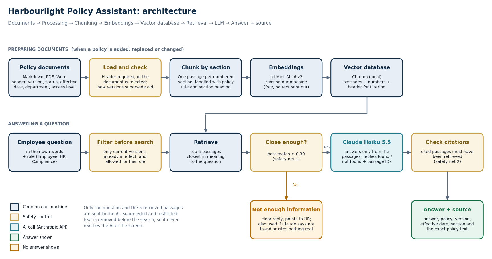

# Product Document: Casino Employee Knowledge Assistant

*Version 1.0 · 6 Nov 2026 · Delivery Lead (Tez) · Status: for review by the Product Owner*

Harbourlight Casino Group is a fictional company. All policies are mock documents written for this project.

## 1. Problem statement

Harbourlight's employees need answers to everyday policy questions, such as how much leave they can carry
forward, what to do if they're ill on a shift, or how to report a lost laptop. Today those answers are spread
across many documents owned by different departments, so employees either search through files or ask HR and
Compliance directly.

This causes three business problems:

- **Time lost** for employees, and repeated routine questions for the HR and Compliance teams.
- **Inconsistent answers**, depending on who is asked.
- **Compliance risk.** In a licensed gambling business, following an **outdated or wrong policy** (for example an
  old leave rule, or the wrong way to report suspected money laundering) has real consequences.

**The product:** an internal assistant that answers in plain English **only from current, approved
policies**. Every answer shows the policy, version, section and exact text it came from, and the assistant
says clearly when the policies don't cover a question rather than guessing.

## 2. Users and stakeholders

| Who | Need |
|---|---|
| **Venue employees** (gaming floor, cage, security, hospitality) | Quick, reliable answers on breaks or at staff terminals (phones aren't allowed on the gaming floor) |
| **Office employees** (Finance, HR, IT, Compliance, Marketing) | The same, plus remote working, expenses and IT rules |
| **Line managers** | One consistent answer to point their team to |
| **HR team** | Fewer routine questions; access to HR-only procedures |
| **Compliance team** | Correct answers on AML, safer gambling and age checks; access to Compliance-only procedures |
| **Policy owners** (e.g. Head of People, Head of Compliance, CISO) | Their current policy is the one used; old versions are retired cleanly |

| Role (client side) | Decides |
|---|---|
| **Project Sponsor** | Go-live and budget |
| **Product Owner** | Scope, priorities, acceptance of business testing |
| **Information Security / DPO** | Access design, and what data may be sent to the AI provider |
| **Policy owners** | Which documents are approved, their access level and when they are replaced |
| **Delivery Lead (Tez)** | Design, build, testing, evidence |

## 3. Scope (V1)

**In scope**

- **17 documents** (15 current, 2 superseded) for General, HR, Finance, Compliance, IT, Security and Customer
  Service: handbook, annual leave, sickness, remote working, onboarding, training, code of conduct,
  information security, IT acceptable use, incident reporting, compliance guidelines, expenses and complaints.
  It also includes **one HR-only** and **one Compliance-only** procedure.
- Ask a question in your own words, and get an answer with its source, or a clear "not enough information".
- Three roles (Employee, HR, Compliance), chosen with a "View as" switch for the demo.
- Policy library (status, version, owner, review date) and upload of PDF, Word or text with required details.

**Out of scope for V1**

- Company sign-in and real permissions (designed in §6, not built).
- Questions about superseded versions ("What was the 2024 rule?").
- Personal data, such as "how many days do *I* have left?" (that needs StaffHub).
- Scanned PDFs (OCR), languages other than English, follow-up questions in a conversation.
- Operations has **no department-owned document** in V1. Operations staff are covered by the handbook,
  incident reporting and complaints procedures.

## 4. Architecture

In short: each policy is split into its numbered sections, and each section is stored with its version, status,
effective date, department and access level. When an employee asks a question, the assistant **first removes**
superseded, not-yet-effective and restricted policies, then finds the 5 closest sections. Claude writes the
answer from those sections only, and the app shows the exact policy text it used.

## 5. Key decisions

Full reasoning, alternatives and business impact: [decision log](casino-knowledge-assistant-03-decision-log.md).
Evidence: [experiment results](casino-knowledge-assistant-07-experiment-results.md).

| Decision | Choice | Why |
|---|---|---|
| Chunking method | One passage per numbered section | Best in tests (100% vs 94–97%). Citations name the section |
| Embedding model | all-MiniLM-L6-v2, runs locally | Free; policy text isn't sent anywhere to be searched |
| Vector database | Chroma (local) | Free, and can filter by version, status and access level |
| Retrieval method | Filter first, then top 5 by meaning | Old and restricted text can never be retrieved |
| LLM | Claude Haiku 5.5 | Fast (1.5 s average) and low cost (under 1p for 32 questions) |
| Source / citation | Policy, version, effective date, section and exact stored text | The AI cannot invent a quote |
| Version handling | Superseded versions removed before search | Without it, old versions reached half of all searches in testing |
| "Not found" | Two safety nets: score cut-off, then a found / not found reply checked by code | No invented answers in any test run |

## 6. Version handling and access control (design)

**Document versions.** Every document carries a header: `version`, `status` (current / superseded),
`effective_date`, `department`, `access_level`, `owner`, `review_date`, and `supersedes` / `superseded_by`.

- Only documents that are **current** and **already in effect** are searched. A new policy can be loaded before
  its start date and goes live automatically on that date.
- Uploading a new version means choosing which policy it replaces. The old one is marked superseded at once.
- Superseded versions stay in the library for reference but are never used in answers.
- Policies past their review date are flagged in the library so owners can act.

**Access control.** Each document has one access level: `all_staff`, `hr` or `compliance`.

| | V1 (built) | Production (designed) |
|---|---|---|
| Who the user is | "View as" switch | Company sign-in (SSO); role from HR system groups |
| What they can search | Filter applied **before** search, so restricted text never reaches the AI or the screen | Same, extended by department, venue and seniority where needed |
| What they can see in the library | Only documents they may access | Same |
| Who can upload | Anyone (demo) | Policy owners only; access level approved by the owner |
| Audit | None | Log of questions, documents used and role; regular access review by Information Security |

## 7. Risks

| Risk | Impact | Mitigation in V1 | Evidence | Owner |
|---|---|---|---|---|
| **Wrong policy retrieved** | Wrong or incomplete answer | Section chunks; titles on every passage; top 5; answer shows its source | A correct section was found for all 27 answerable questions; one gap (Q19, see §8) | Delivery Lead |
| **Old policy used** | Employee follows an outdated rule | Superseded versions removed before search | 0 outdated answers with filter; 3 failures without it | Policy owners |
| **AI invents an answer** | Employee acts on a made-up rule | Score cut-off; AI must say found / not found; citations checked by code | 0 unsupported answers in 7 runs | Delivery Lead |
| **Employee sees a restricted document** | Confidential HR or AML procedure exposed | Access filter before search; library filtered by role | 0 leaks in all runs | Information Security |
| **Poor document or OCR quality** | Text missing, so answers missing | Uploads with no readable text are rejected; scanned PDFs out of scope | Upload tests | Policy owners |
| **Missing source** | Answer can't be checked | An answer with no valid source is not shown | Automated tests | Delivery Lead |
| **Conflicting policies** | Two current policies disagree | AI told to cite both and say so; uploads ask which policy a new version replaces | Not yet tested with a real conflict | Product Owner |
| **Answer taken as personal advice** | Wrong decision on an individual case | App reminds users to confirm personal cases with HR; "not enough information" replies point to HR | — | Product Owner |
| **Policy text sent to AI provider** | Data leaves the company | Only the question and 5 passages are sent; no personal data in policies | Design | Information Security / DPO |

## 8. Results so far

On 32 test questions ([evaluation sheet](../evals/casino-knowledge-assistant-evaluation.xlsx)), the assistant
achieved **96.9% answer accuracy (31/32), 100% retrieval and correct citation on the 27 answerable questions, 0% unsupported answers, 0 access leaks
and 1.5 s average response time**. The one failure (Q19, what to do about a customer who looks under 18) was a
retrieval gap: the incident procedure stores every incident type in one table, which matches any single question
weakly. The answer was incomplete but honest about what was missing.

## 9. Known limitations

- **Tested on 32 questions written alongside the documents.** Real employee questions will be messier.
- **Marking is automatic** (key facts), so it can be fooled (Q19). The marks need human review.
- **Tables are stored as one passage**, so one row (e.g. "underage person") can be missed.
- **No sign-in**: the role switch is a demo stand-in, and anyone can upload.
- **No policy history**: old versions can't be asked about.
- **One-off questions only**: no follow-up conversation.
- **Text documents only**: no OCR for scanned PDFs.
- **The minimum match score can't separate "no answer" from "answer" on its own.** The AI's found / not found
  reply does most of the work.

## 10. Next steps

| # | Step | Why | Owner |
|---|---|---|---|
| 1 | Business UAT with pilot employees and HR, including the Human check column | Confirm answers are right and useful | Product Owner |
| 2 | Add 20–30 real employee questions to the evaluation | More realistic accuracy | Product Owner |
| 3 | Split tables so each row is its own passage | Fix the Q19 retrieval gap | Delivery Lead |
| 4 | Restrict upload to policy owners | Stop unapproved documents | Information Security |
| 5 | Company sign-in (SSO) with role from HR groups | Replace the demo switch | Information Security |
| 6 | Log unanswered questions | Shows which policies are missing or unclear | Product Owner |
| 7 | HR-only policy history view | Answer "what was the old rule" safely | Product Owner |
| 8 | Online hosting (Streamlit Cloud) for the pilot | Easy access for testers | Project Sponsor (approval) |
